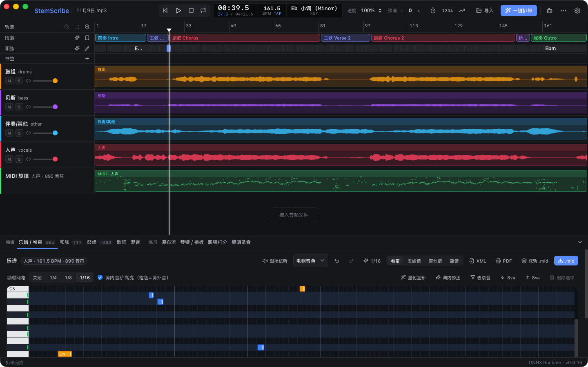
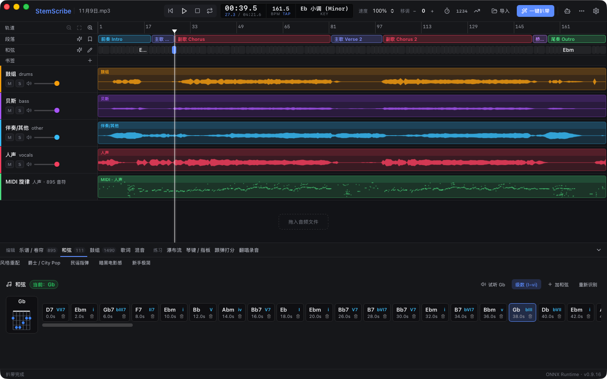
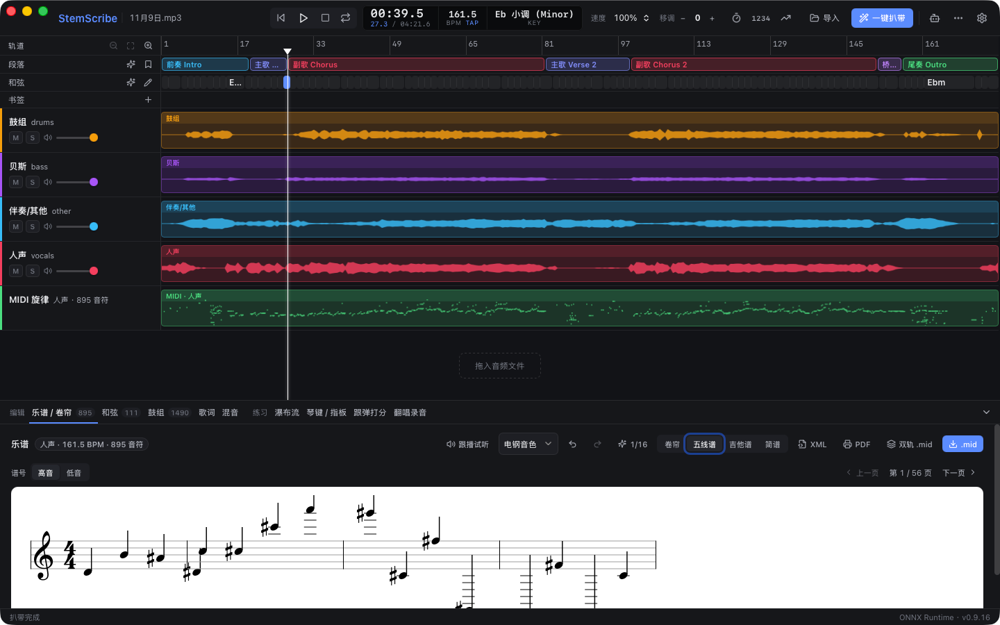
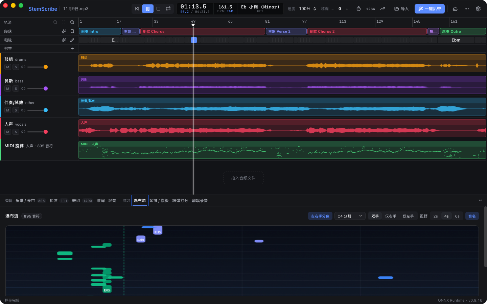
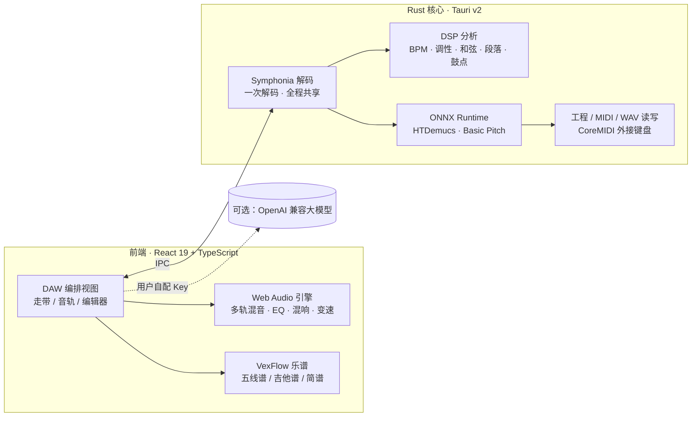

<p align="center">
  
</p>

<h1 align="center">StemScribe</h1>

<p align="center">
  <b>把任何一首歌，变成你能弹、能唱、能练的工程。</b><br/>
  macOS 原生 AI 扒带工作站 · 4 轨分离 · 自动扒谱 · 和弦识别 · 练习 & 翻唱 —— 全部在你的 Mac 上离线完成
</p>

<p align="center">
  <a href="https://github.com/lyinet/stemscribe/releases/latest"></a>
  <a href="https://github.com/lyinet/stemscribe/releases"></a>
  <a href="https://github.com/lyinet/stemscribe/actions"></a>
  
  <a href="LICENSE"></a>
  <a href="https://github.com/lyinet/stemscribe/stargazers"></a>
</p>

<p align="center">
  <a href="#下载安装">下载安装</a> ·
  <a href="#功能一览">功能一览</a> ·
  <a href="#性能">性能</a> ·
  <a href="#技术架构">技术架构</a> ·
  <a href="#路线图">路线图</a> ·
  <a href="#english">English</a>
</p>

<p align="center">
  
</p>

---

## 为什么是 StemScribe

想扒一首歌来弹唱、翻唱或者练琴，通常要来回折腾好几个工具：一个网站分离人声，一个软件扒谱，一个 App 查和弦，再开一个 DAW 慢速循环练习。音频要上传到别人的服务器，还经常按分钟收费。

**StemScribe 把这一整条链路放进了一个经典 DAW 界面里**：拖入一首歌，点一次「一键扒带」，几分钟后你得到 —— 人声 / 鼓 / 贝斯 / 伴奏 4 条独立音轨、带级数的和弦轨、主歌副歌段落、BPM 和调性，以及可以直接编辑、导出成五线谱 / 吉他谱 / 简谱的旋律 MIDI。

- **完全本地**：AI 模型在你的 Mac 上运行，音频不会离开你的电脑，断网也能用。
- **免费开源**：MIT 协议，没有订阅、没有按分钟计费、没有水印。
- **一看就懂**：参考 Logic Pro / ACE Studio 的经典 DAW 布局——上面是走带，中间是音轨，下面是编辑器，设置都收进菜单。

## 三步上手

| 1. 拖入歌曲 | 2. 一键扒带 | 3. 练、改、唱 |
| --- | --- | --- |
| 把 MP3 / WAV / FLAC / M4A 拖进窗口，自动识别 BPM、调性和曲式段落 | AI 拆成 4 轨，识别全曲和弦，提取鼓点，把主旋律转成 MIDI | 变速不变调循环练习、看谱跟弹打分、静音人声叠录翻唱并导出成品 |

## 功能一览

<table>
<tr>
<td width="50%" valign="top">

### AI 4 轨分离
- 基于 Meta **HTDemucs**，分出人声、鼓组、贝斯、伴奏
- 每轨独立静音 / 独奏 / 音量，一键切换练习场景（伴奏消人声、去掉鼓、突出贝斯…）
- 分轨结果随工程保存，下次打开秒开

</td>
<td width="50%" valign="top">

### 自动扒谱
- 基于 Spotify **Basic Pitch**，任意音轨一键转 MIDI
- 钢琴卷帘修音：量化、去杂音、八度移动、撤销 / 重做
- 一键切换 **五线谱 / 吉他谱 / 简谱**，导出 MIDI、MusicXML、PDF

</td>
</tr>
<tr>
<td valign="top">

### 和弦 · 调性 · 段落
- 全曲和弦自动识别，显示级数（I–vi），附吉他指法图
- 自动识别调性、BPM、前奏 / 主歌 / 副歌 / 尾奏
- 和弦风格重配：爵士 / City Pop、民谣指弹、暗黑电影感、新手极简

</td>
<td valign="top">

### 练习模式
- 变速不变调（50%–125%）、移调 ±6 半音、A-B 循环、渐进提速
- 节拍器 + 预备拍、Synthesia 式瀑布流、交互琴键 / 吉他指板
- 实时调音器 + 麦克风 / USB-MIDI 跟弹打分，练习记录可导出

</td>
</tr>
<tr>
<td valign="top">

### 翻唱录音棚
- 消掉原唱跟伴奏叠录，可调声卡 / 耳机延迟补偿
- 合轨导出成品 WAV、循环区切片、SRT 字幕
- 一键生成小红书 / B 站分享卡片

</td>
<td valign="top">

### 舞台 & 效率
- 演出歌单（Setlist）+ 全屏提词器模式
- 多曲目批量分轨队列、本地工程库
- ⌘K 命令面板，几乎所有操作都有快捷键

</td>
</tr>
<tr>
<td valign="top">

### AI 编曲助手（可选）
- 接入任意 OpenAI 兼容的大模型服务（填自己的 API Key）
- 分析编曲结构与和声，给出练习与改编建议，AI 精修 MIDI
- 不配置也完全不影响本地功能

</td>
<td valign="top">

### 隐私与稳定
- 模型与音频全部本地处理，不上传、不追踪
- 后台任务异常只会报错，不会让 App 闪退；崩溃日志写入 `~/Library/Logs/StemScribe/`
- 模型文件下载后自动校验，坏文件不会被当成模型

</td>
</tr>
</table>

## 截图

| 多轨编排 | 乐谱 / 钢琴卷帘 |
| --- | --- |
|  |  |
| **混音台 & 练习场景** | **瀑布流跟弹** |
|  |  |

## 性能

实测于 **Apple M4** 芯片的 Mac，StemScribe v0.9.16 正式构建：

| 任务 | 输入 | 耗时 |
| --- | --- | --- |
| 导入 + 波形 / BPM / 调性 / 段落分析 | 4 分 21 秒 MP3 | 约 1 秒 |
| AI 4 轨分离（HTDemucs） | 85 秒歌曲 | 36 秒 |
| AI 4 轨分离（HTDemucs） | 4 分 21 秒歌曲 | 约 2 分钟 |
| 人声转 MIDI（Basic Pitch） | 4 分 21 秒人声轨 | 4 秒（895 个音符） |
| **一键扒带全流程**（分轨 + 和弦 + 鼓点 + 转谱） | 4 分 21 秒歌曲 | **2–3.5 分钟** |

> 分轨耗时约为歌曲时长的一半，期间界面可以正常操作。安装包仅约 10 MB，AI 模型首次使用时按需下载。

## 下载安装

1. 前往 **[Releases](https://github.com/lyinet/stemscribe/releases/latest)** 下载 `StemScribe_x.y.z_aarch64.dmg`
2. 打开 dmg，把 StemScribe 拖进「应用程序」
3. 首次打开如果提示「无法验证开发者」：打开 **系统设置 → 隐私与安全性**，在页面底部点「仍要打开」
   - 或在终端执行：`/usr/bin/xattr -d com.apple.quarantine /Applications/StemScribe.app`

> 当前为预发布版，使用 ad-hoc 签名，尚未经过 Apple 公证，所以会有上面的提示。

**系统要求**：macOS 13 Ventura 及以上 · Apple Silicon（M1 / M2 / M3 / M4）· 建议 8 GB 内存以上

### 首次使用：下载 AI 模型

第一次点「AI 分轨」或「转 MIDI」时，StemScribe 会提示下载模型，点一下即可（也可在 **设置 → 本地模型** 中管理）：

| 模型 | 用途 | 大小 | 来源 | 协议 |
| --- | --- | --- | --- | --- |
| HTDemucs（4 轨） | 人声 / 鼓 / 贝斯 / 伴奏分离 | 约 166 MB | [Meta Demucs](https://github.com/facebookresearch/demucs) · [ONNX 版](https://huggingface.co/StemSplitio/htdemucs-onnx) | MIT |
| Basic Pitch | 音频转 MIDI | 约 230 KB | [Spotify Basic Pitch](https://github.com/spotify/basic-pitch) | Apache-2.0 |

模型保存在 `~/Library/Application Support/StemScribe/models/`，下载一次后完全离线可用。网络受限时，可以用浏览器下载后在模型管理器里「从本地导入 .onnx」。

## 常用快捷键

| 操作 | 快捷键 | 操作 | 快捷键 |
| --- | --- | --- | --- |
| 播放 / 暂停 | `Space` | 命令面板 | `⌘ K` |
| 导入音频 | `⌘ O` | 导入 MIDI | `⌘ I` |
| 保存工程 | `⌘ S` | 导出 MIDI | `⌘ E` |
| 设置循环起点 / 终点 | `[` / `]` | 添加书签 | `K` |
| 撤销 / 重做修音 | `⌘ Z` / `⇧ ⌘ Z` | 1/16 量化 | `⌘ U` |
| 演出提词器 | `F` / `⇧ ⌘ F` | 弹唱谱排版打印 | `⌘ P` |
| 设置 | `⌘ ,` | 全部快捷键 | `?` |

## 技术架构



| 层 | 技术 |
| --- | --- |
| 桌面框架 | Tauri v2（原生 WebKit，安装包约 10 MB） |
| 核心 | Rust 2021 · Symphonia · Hound · Midly · Midir（CoreMIDI） |
| AI 推理 | ONNX Runtime（`ort`）· HTDemucs · Basic Pitch |
| 界面 | React 19 · TypeScript · Vite · VexFlow · Lucide |
| 音频 | Web Audio API（多轨混音、EQ、卷积混响、节拍器、合成器） |
| CI / 发布 | GitHub Actions（macOS 15 arm64）自动测试、打包、发布 Release |

<details>
<summary><b>项目结构</b></summary>

```
src/                      React 前端
  components/daw/         走带栏、编排视图、混音台
  components/             乐谱、和弦、鼓组、歌词、练习、翻唱、设置等
  lib/                    IPC 封装、Web Audio 引擎、录音、乐理工具
src-tauri/src/
  audio/                  解码与 DSP 分析（BPM / 调性 / 和弦 / 段落 / 鼓点）
  ml/                     HTDemucs 分轨、Basic Pitch 转谱、模型下载与校验
  llm/                    OpenAI 兼容大模型中转
  project/                工程、练习记录、歌单、录音存档
scripts/                  静态校验与辅助脚本
```

</details>

## 从源码构建

需要 Node.js 22+、Rust stable、Xcode Command Line Tools。

```bash
git clone https://github.com/lyinet/stemscribe.git
cd stemscribe
npm ci

npm run tauri dev      # 桌面端开发调试
npm run dev            # 只调前端（浏览器 + 模拟数据，http://localhost:1420）
npm run check          # 提交前全量校验：静态检查 + tsc + vite build + cargo test
npm run build:mac      # 打包 .app 与 .dmg（Apple Silicon）
```

> 如果 `npm run build:mac` 报 `xattr: option -r not recognized`，说明 PATH 中有 Conda 等自带的 `xattr`，改用 `PATH=/usr/bin:$PATH npm run build:mac`。

## 路线图

- [x] 经典 DAW 界面：走带 / 多轨编排 / 底部编辑器 / 独立设置页
- [x] 本地 HTDemucs 4 轨分离 + Basic Pitch 扒谱，模型一键下载与校验
- [x] 和弦 / 调性 / BPM / 段落识别，和弦风格重配
- [x] 练习模式：变速不变调、A-B 循环、瀑布流、跟弹打分
- [x] 翻唱叠录与合轨导出、演出歌单与提词器
- [ ] Apple 开发者签名与公证，双击即可打开
- [ ] 6 轨分离（吉他 / 钢琴单独成轨）
- [ ] 歌词自动识别与对齐（Whisper）
- [ ] 吉他六线谱（TAB）自动生成
- [ ] Apple Neural Engine 加速分轨
- [ ] 英文界面 · Intel Mac / Windows 版本

有想要的功能？欢迎在 [Issues](https://github.com/lyinet/stemscribe/issues) 里告诉我们。

## 常见问题

<details>
<summary><b>提示「已损坏，无法打开」或「无法验证开发者」？</b></summary>

这是因为预发布版还没有经过 Apple 公证。到 **系统设置 → 隐私与安全性** 点「仍要打开」，或在终端执行
`/usr/bin/xattr -d com.apple.quarantine /Applications/StemScribe.app`。
</details>

<details>
<summary><b>分轨模型下载失败 / 很慢？</b></summary>

模型托管在 Hugging Face。网络受限时，可以在模型管理器中把下载地址换成镜像地址，或用浏览器下载 `.onnx` 后点「从本地导入 .onnx」。下载的文件会自动校验，不完整或不是模型的文件会被拒绝。
</details>

<details>
<summary><b>我的音频会被上传吗？</b></summary>

不会。分轨、扒谱、和弦识别等全部在本机完成。只有你主动在设置里配置了 AI 编曲助手并点击使用时，才会把和弦 / 段落等文字信息（不含音频）发给你自己配置的大模型服务。
</details>

<details>
<summary><b>App 出问题了怎么反馈？</b></summary>

请在 [Issues](https://github.com/lyinet/stemscribe/issues) 中描述操作步骤，并附上 `~/Library/Logs/StemScribe/crash.log`（如果有）以及 ⌘K 命令面板 →「系统诊断」里一键复制的报告。
</details>

## 致谢

StemScribe 站在这些优秀开源项目的肩膀上：
[Demucs](https://github.com/facebookresearch/demucs) ·
[Basic Pitch](https://github.com/spotify/basic-pitch) ·
[ONNX Runtime](https://github.com/microsoft/onnxruntime) ·
[ort](https://github.com/pykeio/ort) ·
[Tauri](https://github.com/tauri-apps/tauri) ·
[Symphonia](https://github.com/pdeljanov/Symphonia) ·
[VexFlow](https://github.com/0xfe/vexflow) ·
[Lucide](https://github.com/lucide-icons/lucide)

## License

[MIT](LICENSE) © 2026 lyinet。HTDemucs 模型遵循 MIT 协议，Basic Pitch 模型遵循 Apache-2.0 协议，版权归各自作者所有。

如果 StemScribe 帮你扒到了想弹的那首歌，**点个 Star** 就是对我们最大的鼓励。

[](https://star-history.com/#lyinet/stemscribe&Date)

---

## English

**StemScribe** is a native macOS (Apple Silicon) AI music workstation that turns any song into a playable, editable project — fully offline.

- **4-stem separation** (vocals / drums / bass / other) with Meta's HTDemucs, running locally via ONNX Runtime
- **Audio-to-MIDI transcription** with Spotify's Basic Pitch, with piano-roll editing and score / guitar / numbered-notation export (MIDI, MusicXML, PDF)
- **Chord, key, tempo and song-structure detection**, chord re-harmonization in several styles
- **Practice tools**: time-stretch without pitch change, transpose, A-B loop, progressive speed-up, falling notes, tuner and play-along scoring via mic or USB-MIDI
- **Cover studio**: record over the instrumental and export a mixed WAV; setlists and a full-screen prompter for live shows
- Classic DAW layout (transport · tracks · editor), built with Tauri v2 + Rust + React. ~10 MB installer, MIT licensed.

Download the latest `.dmg` from [Releases](https://github.com/lyinet/stemscribe/releases/latest) (macOS 13+, Apple Silicon). The UI is currently in Chinese; English localization is on the roadmap.
